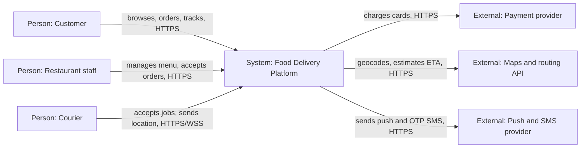
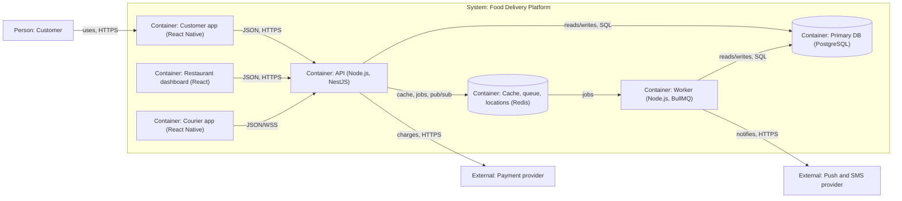
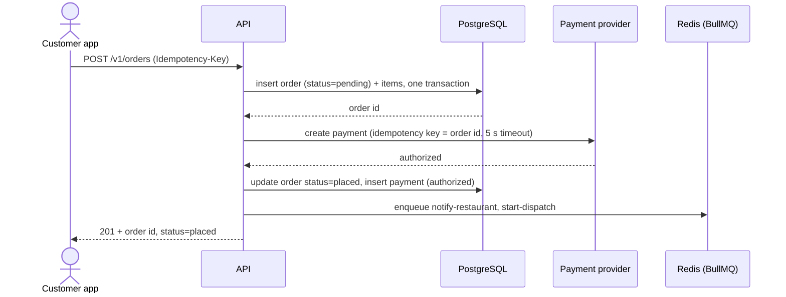

# System Design

> Scope: Food-delivery platform (customer app, restaurant dashboard, courier app, backend)
> Context: 50k users, team of 4, Node.js preferred, cost-sensitive, single launch city
> Format: 1.0.2
> Audit: plugin 1.0.2 · scanner not run · rev unknown · 2026-11-02T18:30:00Z

## Overview

A food-delivery platform where customers order from nearby restaurants, restaurants accept and prepare orders, and couriers deliver them with live tracking. A team of 4 must build and run it, so operational simplicity outranks independent scaling.

## System Context

## Core Components

| Component | Responsibility | Required now / Later | Why it exists |
|---|---|---|---|
| Customer app | Browse restaurants, order, pay, track | Required now | Primary revenue channel |
| Restaurant dashboard | Menu management, accept and ready orders | Required now | Restaurants work from a tablet browser, no store install |
| Courier app | Job offers, status updates, location pings | Required now | Needs background GPS, so native |
| API (modular monolith) | Modules: identity, catalog, ordering, payments, dispatch, tracking | Required now | One deployable for a team of 4; modules keep boundaries for a later split |
| Worker | Notifications, payment webhooks, dispatch retries | Required now | Keeps slow external calls off the request path |
| PostgreSQL | Users, restaurants, menus, orders, payments, deliveries | Required now | Transactions for order and payment state |
| Redis | Menu cache, BullMQ jobs, latest courier positions, rate limits | Required now | One extra store covers four needs |
| Search service | Full-text restaurant and dish search | Later: when restaurants exceed about 2,000 or PostgreSQL search p95 passes 300 ms | A single launch city is small enough for PostgreSQL and PostGIS filters |

`Later` components stay out of the diagram until their trigger is met.

## Data Flow

Main request: place order

- The `Idempotency-Key` is stored with a unique index on `orders`, so a retried request returns the first order instead of a second charge.
- Card authorization only; capture happens when the restaurant accepts, so a rejected order needs no refund.
- A failed notify or dispatch job retries with exponential backoff (5 tries), then alerts on-call; the order stays `placed`.

## Capacity Estimates

Formulas in `references/capacity-estimation.md`.

| Metric | Formula | Value |
|---|---|---|
| Daily requests | 10,000 DAU × 30 + 200 couriers × 2,880 location pings | 876,000 |
| Average QPS | 876,000 / 86,400 | ≈ 10.1 |
| Peak QPS | 3× average | ≈ 30 |
| Read / write split | 240,000 reads / 636,000 writes per day (27% / 73%) of peak QPS | ≈ 8 / 22 |
| Storage per year | 60,000 persisted writes/day × 1 KB × 365 × 3 | ≈ 66 GB |
| Bandwidth (peak) | 30 × 10 KB | ≈ 0.3 MB/s (≈ 2.4 Mbit/s) |
| Cache size (hot set) | 20% × 240,000 reads/day × 2 KB | ≈ 96 MB |

Location pings are 90% of writes but go to Redis, not PostgreSQL: one API pair, one PostgreSQL primary with a standby and one small Redis carry this load without sharding.

## Key Architectural Decisions

| Decision | Chosen | Alternative considered | Why |
|---|---|---|---|
| Architecture pattern | Modular monolith (Node.js, NestJS) | Microservices | Team of 4 at 30 peak QPS cannot carry per-service ops |
| Primary database | PostgreSQL | MongoDB | Orders and payments need multi-row transactions |
| Live courier tracking | Redis latest-position keys + pub/sub over WebSocket | Polling positions stored in PostgreSQL | About 90% of writes are pings; keep them off the primary DB |
| Background work | BullMQ job queue on Redis | Kafka | Reuses Redis; job volume is thousands per day, not millions |
| Payments | Hosted payment provider with tokenised cards and idempotency keys | Storing and charging cards in-house | Keeps the system out of full PCI DSS scope |

Options for the architecture pattern:

| Option | Strength | Weakness | Verdict |
|---|---|---|---|
| Modular monolith | One deploy, in-process calls, transactions across modules | Modules scale together; one bad release hits every domain | Chosen |
| Microservices | Independent scaling and deploys per domain | Per-service ops, tracing and contracts for a team of 4 at 30 peak QPS | Rejected: operations cost exceeds any scaling gain |
| Serverless functions | No servers to patch; pay per call | Cold starts on checkout, awkward WebSocket tracking | Rejected: tracking needs long-lived connections |

ADRs: one per row in `docs/adr/` (shipped in this example under `adr/`).

## Requirements → Decisions

| Requirement | Decision(s) | How it is met |
|---|---|---|
| 50k users, about 30 peak QPS | Architecture pattern, Primary database | One API pair and one PostgreSQL primary carry the load without sharding |
| Team of 4, Node.js preferred | Architecture pattern, Background work | One NestJS deployable and one worker, no service mesh |
| Live courier tracking | Live courier tracking | Latest positions in Redis, pushed over WebSocket |
| No double charge on retries | Payments, Primary database | Provider idempotency key and a unique `idempotency_key` index on orders |
| Card data kept out of scope | Payments | Hosted provider with tokenised cards |
| p95 < 300 ms, 99.9% availability (Assumed) | Primary database, Background work | Managed PostgreSQL with standby; slow external calls run in the worker |
| Cost-sensitive, single launch city | Architecture pattern, Background work | About 300–600 USD/month in one region (see `02`, Deployment & Cost) |

## Assumptions & Constraints

- Users: 50k registered customers (stated); 20% daily active = 10k DAU, 30 requests per DAU (Assumed (non-interactive))
- Couriers: 200 on shift at once, one location ping every 10 s over 8 h (Assumed (non-interactive))
- Team: 4 (stated); mid-level, comfortable with TypeScript (Assumed (non-interactive))
- Stack: Node.js (stated) with TypeScript and PostgreSQL (Assumed (non-interactive), skill default)
- Latency: p95 < 300 ms for API reads and writes, excluding the provider call (Assumed (non-interactive))
- Availability: 99.9% (Assumed (non-interactive))
- Compliance: no special compliance; card data stays with the payment provider (Assumed (non-interactive))
- Cost: cost-sensitive; one cloud region, single launch city (Assumed (non-interactive))
- Sizing inputs: record 1 KB, response 10 KB, menu object 2 KB, peak = 3× average, replication 3 (Assumed (non-interactive))
