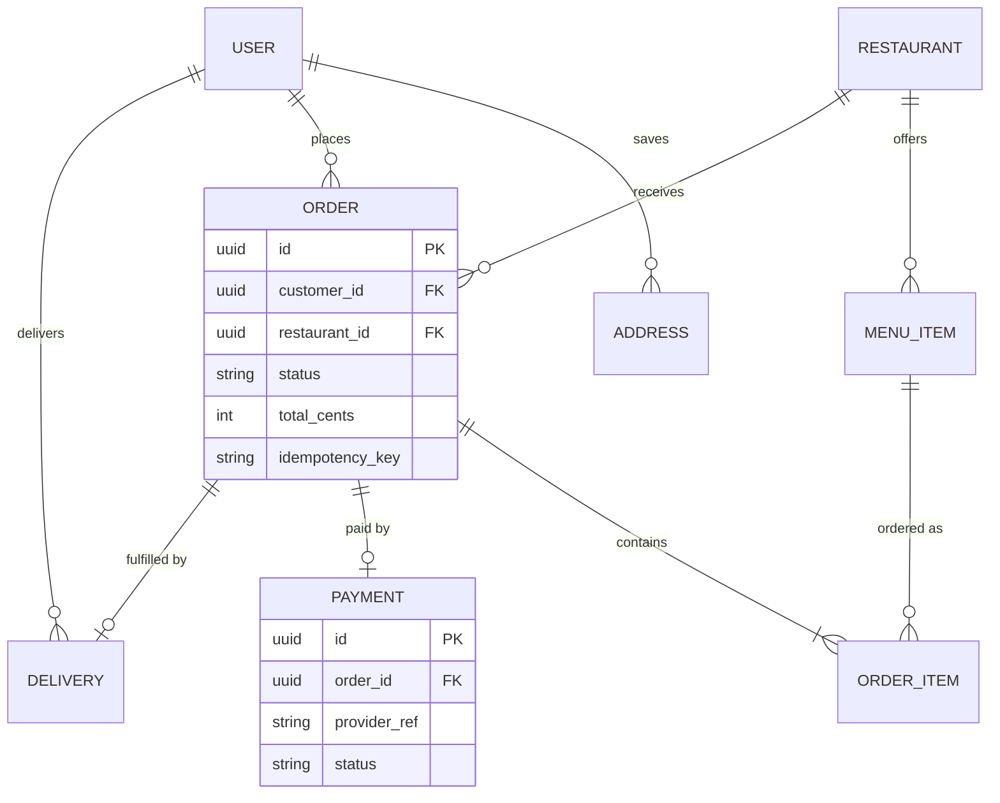

# Architecture Decisions

> Scope: Food-delivery platform (customer app, restaurant dashboard, courier app, backend)
> Context: 50k users, team of 4, Node.js preferred, cost-sensitive, single launch city

## Pattern Choice

**Chosen: Modular Monolith**

- One NestJS API and one worker, built from one repository, with modules identity, catalog, ordering, payments, dispatch and tracking.
- A team of 4 at about 30 peak QPS gains nothing from separate deployables; module boundaries (no cross-module table access, enforced by a lint rule) keep a later split cheap.

## Scaling Strategy

| Layer | Approach | Why |
|---|---|---|
| Compute | Horizontal: 2 stateless API instances, scale to 4 on CPU > 70% | Two instances give zero-downtime deploys; peak needs one |
| Caching | Menus and restaurant lists in Redis | Most customer reads are menus, which change a few times a day |
| Load balancing | Managed L7 load balancer with sticky-free WebSocket support | WebSocket tracking must survive instance restarts by reconnecting |
| Async work | BullMQ on Redis for notifications, webhooks, dispatch retries | External calls stay off the request path |

## Data Storage

| Store | Choice | Why |
|---|---|---|
| Primary DB | Managed PostgreSQL 16 with a hot standby | Transactions for orders and payments; failover without ops work |
| Cache, queue, locations | Managed Redis (1 GB) with AOF persistence | Covers cache, jobs, rate limits and latest courier positions |
| Geo queries | PostGIS on the same PostgreSQL | "Restaurants near me" needs a radius index, not a new store |

## Data Model

| Entity | Key fields | Relationships | Key indexes (why) |
|---|---|---|---|
| User | id, role, phone, name | has many Order, Address | (phone) unique: OTP login |
| Address | id, user_id, location | belongs to User | (user_id): list saved addresses |
| Restaurant | id, name, location, is_open | has many MenuItem, Order | GiST (location): nearby search |
| MenuItem | id, restaurant_id, name, price_cents, available | belongs to Restaurant | (restaurant_id, available): menu load |
| Order | id, customer_id, restaurant_id, status, total_cents, idempotency_key, created_at | has many OrderItem; has one Payment, Delivery | (idempotency_key) unique: safe retries; (customer_id, created_at): history |
| OrderItem | id, order_id, menu_item_id, qty, price_cents | belongs to Order | (order_id): order detail |
| Payment | id, order_id, provider_ref, status, amount_cents | belongs to Order | (provider_ref) unique: webhook dedupe |
| Delivery | id, order_id, courier_id, status, picked_up_at, delivered_at | belongs to Order, User (courier) | (courier_id, status): active jobs |

## Failure Modes

| Scenario | Consequence | Mitigation | Why |
|---|---|---|---|
| PostgreSQL primary fails | Ordering stops | Managed standby, automatic failover < 60 s | Meets 99.9% without an on-call DBA |
| Payment provider slow or down | Checkout hangs, client retries | 5 s timeout, idempotency key per order, clear "try again" error | Retries never double-charge |
| Redis lost | Tracking and cache gone, jobs delayed | AOF persistence; menus fall back to PostgreSQL; positions refill from next ping | Redis holds nothing unrecoverable |
| Courier app offline | Stale position on the map | Show "last seen" age after 30 s; reassign after 5 min silence | Customer sees honest ETA |
| Notification job fails | Restaurant misses an order | 5 retries with backoff, then alert and dashboard banner | A missed order is lost revenue |

## Security

| Threat (STRIDE) | Asset | Mitigation | Why |
|---|---|---|---|
| Spoofing: stolen session token | Customer and courier accounts | 15 min JWT + rotating refresh token, revoke on logout | Limits the window of a leaked token |
| Tampering: client-sent prices | Order totals | Server recomputes totals from MenuItem prices | Clients are untrusted |
| Repudiation: disputed delivery | Delivery records | Append-only status history with actor and timestamp | Settles disputes with evidence |
| Information disclosure: customer addresses | User and Address tables | Couriers see the address only while assigned; encrypted at rest | Limits location exposure |
| Denial of service: OTP flooding | SMS budget, login | 5 OTP requests per phone per hour, per-IP limits | SMS costs money per message |
| Elevation of privilege: restaurant edits another menu | Catalog | Every query scoped by `restaurant_id` from the token | Tenant isolation |

## Observability

| Signal | What | Alert threshold | Why |
|---|---|---|---|
| Logs | Structured JSON with request ID, user ID, order ID | — | Trace one order across API and worker |
| Metrics (RED) | Rate, errors, duration per endpoint | 5xx > 1% for 5 min; p95 > 300 ms for 10 min | Matches the latency target |
| Metrics (USE) | CPU, memory, DB connections, BullMQ queue depth | DB connections > 80%; queue depth > 500 for 5 min | Early warning before user impact |
| Business | Orders placed per 15 min vs same slot last week | Drop > 50% in a meal peak | Catches silent checkout failures |
| Traces | OpenTelemetry across API → PostgreSQL → provider | — | Shows which hop makes checkout slow |

## Deployment & Cost

| Component | Runs on | Size / count | Monthly cost (USD) |
|---|---|---|---|
| API | Managed containers | 2 × 1 vCPU, 2 GB | 60–100 |
| Worker | Managed containers | 1 × 0.5 vCPU, 1 GB | 15–30 |
| PostgreSQL | Managed PostgreSQL | 2 vCPU, 8 GB + standby, 100 GB | 150–300 |
| Redis | Managed Redis | 1 GB | 30–60 |
| Load balancer, logs, metrics | Cloud provider services | 1 LB, 30-day log retention | 50–100 |

Total: about 300–600 USD/month. Assumptions: one region, ≈ 30 peak QPS from Capacity Estimates, on-demand pricing; payment fees, maps calls and SMS are usage-billed and excluded.

## Trade-offs Accepted

- Independent scaling and deploys per domain for one simple deployable a team of 4 can run.
- A stored location history for cheap, fast latest-position writes in Redis (track history is not kept).
- Card capture delay (authorize at order, capture on accept) for no refunds on rejected orders.
- Kafka-grade event replay for BullMQ's simpler operations at thousands of jobs per day.
