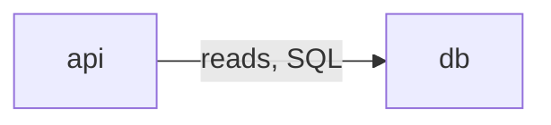

# Formatting Rules

Read before writing any output file. Applies to every mode and file: Mode 1, Mode 2, Quick, optional `04`, and ADRs.

## Core Rules

| # | Rule | Why |
|---|---|---|
| 1 | Discipline over verbosity: about half a page per section | Keeps files reviewable in minutes |
| 2 | Tables wherever there are more than 2 comparable items | Comparisons are scannable in tables, not paragraphs |
| 3 | Bullets for lists; no walls of prose | Faster to read and diff |
| 4 | Every recommendation or fix includes a one-line "Why" | No unexplained prescriptions |
| 5 | No filler: omit sections that do not apply | Padding hides the useful content |
| 6 | Standard headers, in order, across modes and files | Files read like one system, not ad hoc reports |
| 7 | Diagrams in Mermaid by default (see Diagrams) | Renders on GitHub and most editors, stays diffable |

## The "Why" Line

Every row or bullet that recommends something ends with a short reason.

| Bad | Good |
|---|---|
| Use Redis for caching. | Use Redis for caching. Why: hot reads dominate traffic and PostgreSQL is the bottleneck. |
| Add pagination. | Add cursor pagination to `/orders`. Why: unbounded lists slow responses as data grows. |

- One line, under about 20 words.
- In tables, use a dedicated `Why` column, placed last.

## Standard Headers

Use these exact names, in this order. Omit a header only when the section does not apply (no empty filler sections); the linter accepts omitted headers but flags renamed, unknown or out-of-order ones. Never rename headers. A header marked "(re-run only)" appears only when a previous run was archived; the marker is not part of the heading.

### Mode 1

| File | Headers (in order) |
|---|---|
| `01-system-design.md` | Overview, System Context, Core Components, Data Flow, Capacity Estimates, Key Architectural Decisions, Requirements → Decisions, Assumptions & Constraints |
| `02-architecture-decisions.md` | Pattern Choice, Scaling Strategy, Data Storage, Data Model, Failure Modes, Security & Threat Model, Observability, Deployment & Cost, Trade-offs Accepted |
| `03-api-design-and-optimization.md` | API Style, Endpoint Conventions, Endpoints, Auth & Rate Limiting, Caching Strategy, Performance Notes |

### Mode 2

| File | Headers (in order) |
|---|---|
| `01-architecture-issues.md` | Change Since Last Audit (re-run only), Architecture Health Score, Critical Issues, High Issues, Medium / Low Issues |
| `02-api-optimization.md` | API Health Snapshot, Endpoint Inventory, Issues Found, Caching Opportunities, Quick Wins vs Structural Fixes |
| `03-improvement-roadmap.md` | Quick Wins (days), Medium-term (weeks), Long-term (months/quarters), Suggested Sequence |

The health-score heading carries the result: `## Architecture Health Score: <Band> (<X.X> / 10)` (see `references/health-score-rubric.md`). On a re-run, `### Score Trend` sits inside Change Since Last Audit (output of `scripts/compare_audits.py`).

### Quick

| File | Headers (in order) |
|---|---|
| `quick-design.md` | Overview, Architecture, Key Decisions, API Sketch, Risks, Assumptions & Constraints |
| `quick-audit.md` | Change Since Last Audit (re-run only), Health Band, Top Issues, Quick Wins, Next Steps |

### Optional

| File | Headers (in order) |
|---|---|
| `04-tech-stack-comparison.md` | Comparison Table, Recommendation, When to Reconsider |

### ADR

| File | Headers (in order) |
|---|---|
| `NNNN-<kebab-title>.md` | Context, Decision, Consequences |

Format 1.0.2 ADRs add `## Alternatives` (after Context) and `## Assumptions` (last): Context, Alternatives, Decision, Consequences, Assumptions.

### Required Headers

These always apply and are never omitted (the linter reads this list). ADR sections are all required.

- Required in `01-architecture-issues.md`: Architecture Health Score
- Required in `02-api-optimization.md`: Issues Found
- Required in `03-improvement-roadmap.md`: Suggested Sequence
- Required in `quick-audit.md`: Health Band
- Required in `01-system-design.md`: Overview, Assumptions & Constraints
- Required in `quick-design.md`: Overview, Assumptions & Constraints

### Format 1.0.1 (archived runs only)

Files without `> Format: 1.0.2` were written with these older headers; the linter accepts them so archived runs still lint. Never write them for new output.

| File (1.0.1) | Headers (in order) |
|---|---|
| `1.0.1/01-system-design.md` | Overview, System Context, Core Components, Data Flow, Capacity Estimates, Key Architectural Decisions, Assumptions & Constraints |
| `1.0.1/02-architecture-decisions.md` | Pattern Choice, Scaling Strategy, Data Storage, Data Model, Failure Modes, Security, Observability, Deployment & Cost, Trade-offs Accepted |

## File Skeleton

```markdown
# <File Title>

> Scope: <one line: project or folders covered>
> Context: <one line: scale, team, key constraints>
> Format: 1.0.2
> Audit: plugin 1.1.0 · scanner schema 3 · rev <sha|unknown> · config <config_hash> · <timestamp>

## <Section 1>
...
```

- One `#` title per file, `##` for sections, `###` only if a section needs sub-parts.
- Scope and Context lines are mandatory at the top of every file except ADRs, which use `Date:` and `Status:` lines (template in `templates/adr/`).
- `> Format: 1.0.2` goes in every file, ADRs included; it switches on the 1.0.2 linter checks.
- `> Audit:` values come from the scanner JSON `meta` block (`plugin_version`, `schema_version`, `repo_revision`, `timestamp`). The scanner always emits `config_hash` (an empty config still has one), so write `· config <config_hash>` after the revision on every scanned audit (the skeleton shows the position). Add `· <harness/model>` when known. Design files without a scan write `scanner not run`. Without a scan, write `rev unknown` unless the user gave the revision (you run no `git` command), and take the timestamp from the harness when known, or leave it out. Rule versions are recorded only in the scanner JSON `meta`; the Audit line does not repeat them.

## Issue IDs

| Prefix | Category |
|---|---|
| `SYS-` | System Design |
| `API-` | API Design |
| `SCL-` | Scalability |
| `REL-` | Reliability |
| `SEC-` | Security |
| `OBS-` | Observability |
| `MNT-` | Maintainability |

- Format `PREFIX-NNN`, zero-padded, starting at `001` per prefix (`SEC-001`).
- **Single-definition rule:** `API-*` issues are defined only in `02-api-optimization.md`; every other issue only in `01-architecture-issues.md`. Other files reference IDs, never restate the row.
- The roadmap's Action cell starts with the ID(s) it resolves. Every defined ID appears in exactly one `Action (IDs)` row (scored issues; `informational` / `not-reproducible` at most one) across the three horizon tables (Quick Wins, Medium-term, Long-term); Suggested Sequence may cite IDs again.
- Quick audit defines every issue in Top Issues; Quick Wins and Next Steps together reference each ID exactly once (`informational` and `not-reproducible` issues at most once).

## Table Standards

| Rule | Detail |
|---|---|
| Header row | Always present, short column names |
| Cell length | One line per cell; move detail to bullets under the table |
| Column order | Subject first, decision or fix next, `Why` last |
| Severity | Exactly: Critical, High, Medium, Low |
| Effort | Exactly: S (hours), M (days), L (weeks), XL (months) |
| Impact | Exactly: Low, Medium, High. Free-text effects go in a `Consequence` column |
| Evidence | `path:line` from the audited code, root-relative (`services/payments/src/charge.ts:42`) |

### Issue Table (Critical Issues, High Issues)

| ID | Status | Source | Issue | Evidence | Root cause | Consequence | Fix | Verify | Why |
|---|---|---|---|---|---|---|---|---|---|

### Combined Issue Table (Medium / Low Issues, Issues Found)

| ID | Severity | Status | Source | Issue | Evidence | Root cause | Consequence | Fix | Verify | Why |
|---|---|---|---|---|---|---|---|---|---|---|

### Quick Audit Issue Table (Top Issues)

| ID | Severity | Status | Source | Issue | Evidence | Fix | Verify | Why |
|---|---|---|---|---|---|---|---|---|

### Finding Fields

| Field | Values / rule |
|---|---|
| Status | `confirmed` (you read the code, the defect is visible), `likely` (strong evidence, depends on runtime), `needs-review` (heuristic, could not decide; required when the scanner signal carries `uncertain_reason`, unless resolved as Uncertain signals below says), `informational` (worth knowing, not a defect: a deliberate trade-off, a pattern to watch; is not scored, needs no Verify, detail line or roadmap row, but its Evidence must still resolve), `not-reproducible` (re-run only: the previous run's issue is gone; the row stays for this run only, is not scored, needs no Verify, detail line or roadmap row, its Evidence may be stale, and `compare_audits.py` counts it as Fixed) |
| Source | `scanner:<rule>` (e.g. `scanner:http-no-timeout`; bare `scanner` is not allowed), `agent` (found by reading), `scanner+agent` (optionally `scanner+agent:<rule>`) |
| Evidence | `path:line[-line]`, several separated by `, `; secrets never copied. For an absence (no tests, no health route, no lockfile), cite the folder or file inspected as a bare path (`services/orders/`, `services/orders/go.mod`) |
| Root cause | short text; `RC-n` when 2+ issues share it |
| Verify | a concrete check that proves the fix: a test, a command, a metric. Required for High and Critical; `—` allowed for Medium/Low |
| Related (optional) | `Related: <IDs>` at the end of the detail line: other issues that share a code path or must be fixed together (each ID defined in this run); unlike `RC-n`, no shared cause is implied. Omit the field when there are none; never write `Related: none` |
| First seen (optional) | `First seen: <date or version>` at the end of the detail line: the run that first reported the issue, as the date of that run's `> Audit:` timestamp (`2026-09-01`), not the archive folder name (the folder is named for the day it was archived), or the plugin version (`1.0.2`), read from the archived runs |

- **Dedup:** one issue per root cause; more locations go in Evidence. Different issues sharing a cause cite the same `RC-n`, defined once under the last issue table: `- RC-1: <cause> (<IDs>)`.
- **Detail list:** under each Critical and High table, one line per issue, Medium/Low none: `- SEC-001: Observed: <what the code shows>. Inference: <what you conclude>. Limitations: <counter-evidence or what could not be checked>.` Optional fields follow Limitations: `- SEC-001: Observed: … Limitations: … Related: SEC-003. First seen: 2026-09-01.` A Medium/Low issue gets a detail line only to carry them.
- **Uncertain signals:** an issue that cites a scanner signal with `uncertain_reason` (same rule, file and line) keeps Status `needs-review`. It may leave `needs-review` only when you read the file that resolves the uncertainty (the router mount, gateway, middleware or client config the reason points at): then use Source `scanner+agent:<rule>` and add `Uncertainty resolved: <path:line>` to its detail line, naming that file, which must be another file than the signal's own (a Medium/Low issue gets a detail line to carry it). `lint_output.py --scan docs/architecture/.scan/scan.json` enforces this for `scanner:<rule>` (always `needs-review`), `scanner+agent:<rule>` and bare `scanner+agent` (which matches every rule), and checks that the scan file is the one this audit was built from: its `meta` timestamp and config hash must match the `> Audit:` and `> Scope:` lines (every scanned scope folder named on the Scope line). Audit several folders in one scan by repeating the `--scope` flag.
- Severity comes from Severity Definitions in `references/mode-2-existing-project.md`; the scanner's `severity_hint` is a starting point.

### Decision Table

| Decision | Chosen | Alternative considered | Why |
|---|---|---|---|

### Roadmap Table

| Action (IDs) | Effort | Impact | Why |
|---|---|---|---|

- Placement: S -> Quick Wins, M -> Medium-term, L/XL -> Long-term.
- Suggested Sequence order: (1) Critical issues, pain-point issues first among them; (2) other pain-point issues; (3) High issues of the weakest category; (4) remaining items by Impact and Effort (high impact, low effort first). Within a group, rank by value × confidence (`confirmed` before `likely` before `needs-review`); when a small change and a large refactor both remove the root cause, the small change goes first.

## Diagrams

- Default: Mermaid fenced blocks (` ```mermaid `). Use ASCII only when the user asks for plain text or terminal output, or the target clearly cannot render Mermaid.
- Max about 12 nodes per diagram; split into two beyond that.
- C4 diagrams use Mermaid `flowchart LR` with C4 labelling, not Mermaid's experimental `C4Context` syntax:

| Element | Label | Shape |
|---|---|---|
| Person | `Person: <role>` | `["..."]` |
| Software system (yours) | `System: <name>` | `["..."]`; containers go in a `subgraph` named after it |
| Container | `Container: <name> (<tech>)` | `["..."]`, databases `[("...")]` |
| External system | `External: <name>` | `["..."]` |
| Relationship | `-->\|"<verb>, <protocol>"\|` | labelled arrow |

Edge syntax (unescaped):



- C4 Context: your system as one box plus people and external systems only. C4 Container: the containers inside your system.
- Data Flow: Mermaid `sequenceDiagram` for the main request. Data Model: Mermaid `erDiagram`, max 8 entities.
- Mode 2 may add one current-state container diagram in `01` only when it clarifies a System Design issue. Put it under a `###` heading inside the Critical, High or Medium / Low Issues section that holds that SYS issue, never as a new `##` header.

## Wording Rules

- Direct and specific: name the component, endpoint, file or number.
- One choice per decision. No "it depends" without a pick.
- Numbers over adjectives (`p95 < 300 ms`, not `fast`).
- Cite `path:line` in audit issues; mark unverified claims `Not verified`.
- No marketing language, no preamble, no closing summary.
- **Proportionality:** no distributed system, queue, cache, extra datastore or microservice without a stated reason tied to a requirement or a Capacity Estimates number. If nothing requires it, it is `Later` or left out.

## Length Limits

| Element | Limit |
|---|---|
| Overview | 2–3 lines (the Requirements table does not count) |
| Prose block | 4 lines maximum |
| "Why" line | 1 line |
| Section | About half a page |
| Mode 1 file | About 3–4 pages |
| Mode 2 file | About 2–3 pages |
| Quick file | About 1.5 pages |
| ADR | 1 page maximum |

The OpenAPI skeleton block in `03-api-design-and-optimization.md` does not count toward the section limit.

## Pre-Write Checklist

- [ ] Standard headers used, in order; re-run-only headers only on re-runs
- [ ] Scope, Context, Format and Audit lines at the top (ADRs: Date, Status, Format)
- [ ] Issue rows carry Status, Source and Verify (High/Critical); High/Critical have a detail line; shared causes use `RC-n`
- [ ] Tables for every comparison of 3+ items
- [ ] Every recommendation has a "Why"
- [ ] Severity, Effort and Impact use the fixed vocabulary
- [ ] Every issue has one ID, defined once, cited with `path:line`, and sits in exactly one roadmap `Action (IDs)` row (scored issues; `informational` / `not-reproducible` at most one)
- [ ] Diagrams are Mermaid (ASCII only per the fallback rule), max about 12 nodes
- [ ] No filler sections, no generic boilerplate
- [ ] `lint_output.py docs/architecture --repo <root> --scan docs/architecture/.scan/scan.json` (audits; design files take no flags) reports `lint: clean`
