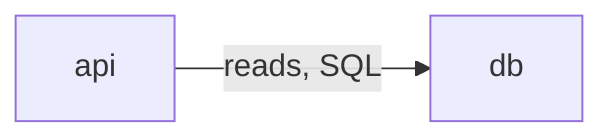

# Formatting Rules

Read before writing any output file. Applies to every mode and file: Mode 1, Mode 2, Quick, optional `04`, and ADRs.

## Core Rules

| # | Rule | Why |
|---|---|---|
| 1 | Discipline over verbosity: about half a page per section | Keeps files reviewable in minutes |
| 2 | Tables wherever there are more than 2 comparable items | Comparisons are scannable in tables, not paragraphs |
| 3 | Bullets for lists; no walls of prose | Faster to read and diff |
| 4 | Every recommendation or fix includes a one-line "Why" | No unexplained prescriptions |
| 5 | No filler: omit sections that do not apply | Padding hides the useful content |
| 6 | Standard headers, in order, across modes and files | Files read like one system, not ad hoc reports |
| 7 | Diagrams in Mermaid by default (see Diagrams) | Renders on GitHub and most editors, stays diffable |

## The "Why" Line

Every row or bullet that recommends something ends with a short reason.

| Bad | Good |
|---|---|
| Use Redis for caching. | Use Redis for caching. Why: hot reads dominate traffic and PostgreSQL is the bottleneck. |
| Add pagination. | Add cursor pagination to `/orders`. Why: unbounded lists slow responses as data grows. |

- One line, under about 20 words.
- In tables, use a dedicated `Why` column, placed last.

## Standard Headers

Use these exact names, in this order. Omit a header only when the section does not apply. Never rename headers. A header marked "(re-run only)" appears only when a previous run was archived; the marker is not part of the heading.

### Mode 1

| File | Headers (in order) |
|---|---|
| `01-system-design.md` | Overview, System Context, Core Components, Data Flow, Capacity Estimates, Key Architectural Decisions, Assumptions & Constraints |
| `02-architecture-decisions.md` | Pattern Choice, Scaling Strategy, Data Storage, Data Model, Failure Modes, Security, Observability, Deployment & Cost, Trade-offs Accepted |
| `03-api-design-and-optimization.md` | API Style, Endpoint Conventions, Endpoints, Auth & Rate Limiting, Caching Strategy, Performance Notes |

### Mode 2

| File | Headers (in order) |
|---|---|
| `01-architecture-issues.md` | Change Since Last Audit (re-run only), Architecture Health Score, Critical Issues, High Issues, Medium / Low Issues |
| `02-api-optimization.md` | API Health Snapshot, Endpoint Inventory, Issues Found, Caching Opportunities, Quick Wins vs Structural Fixes |
| `03-improvement-roadmap.md` | Quick Wins (days), Medium-term (weeks), Long-term (months/quarters), Suggested Sequence |

The health-score heading carries the result: `## Architecture Health Score: <Band> (<X.X> / 10)` (see `references/health-score-rubric.md`).

### Quick

| File | Headers (in order) |
|---|---|
| `quick-design.md` | Overview, Architecture, Key Decisions, API Sketch, Risks, Assumptions & Constraints |
| `quick-audit.md` | Change Since Last Audit (re-run only), Health Band, Top Issues, Quick Wins, Next Steps |

### Optional

| File | Headers (in order) |
|---|---|
| `04-tech-stack-comparison.md` | Comparison Table, Recommendation, When to Reconsider |

### ADR

| File | Headers (in order) |
|---|---|
| `NNNN-<kebab-title>.md` | Context, Decision, Consequences |

## File Skeleton

```markdown
# <File Title>

> Scope: <one line: project or folders covered>
> Context: <one line: scale, team, key constraints>

## <Section 1>
...
```

- One `#` title per file, `##` for sections, `###` only if a section needs sub-parts.
- Scope and Context lines are mandatory at the top of every file except ADRs, which use `Date:` and `Status:` lines (template in `templates/adr/`).

## Issue IDs

| Prefix | Category |
|---|---|
| `SYS-` | System Design |
| `API-` | API Design |
| `SCL-` | Scalability |
| `REL-` | Reliability |
| `SEC-` | Security |
| `OBS-` | Observability |
| `MNT-` | Maintainability |

- Format `PREFIX-NNN`, zero-padded, starting at `001` per prefix (`SEC-001`).
- **Single-definition rule:** `API-*` issues are defined only in `02-api-optimization.md`; every other issue only in `01-architecture-issues.md`. Other files reference IDs, never restate the row.
- The roadmap's Action cell starts with the ID(s) it resolves. Every defined ID appears in exactly one `Action (IDs)` row across the three horizon tables (Quick Wins, Medium-term, Long-term); Suggested Sequence may cite IDs again.
- Quick audit defines every issue in Top Issues; Quick Wins and Next Steps together reference each ID exactly once.

## Table Standards

| Rule | Detail |
|---|---|
| Header row | Always present, short column names |
| Cell length | One line per cell; move detail to bullets under the table |
| Column order | Subject first, decision or fix next, `Why` last |
| Severity | Exactly: Critical, High, Medium, Low |
| Effort | Exactly: S (hours), M (days), L (weeks), XL (months) |
| Impact | Exactly: Low, Medium, High. Free-text effects go in a `Consequence` column |
| Evidence | `path:line` from the audited code, root-relative (`services/payments/src/charge.ts:42`) |

### Issue Table (Critical Issues, High Issues)

| ID | Issue | Evidence | Root cause | Consequence | Fix | Why |
|---|---|---|---|---|---|---|

### Combined Issue Table (Medium / Low Issues, Issues Found)

| ID | Severity | Issue | Evidence | Root cause | Consequence | Fix | Why |
|---|---|---|---|---|---|---|---|

### Quick Audit Issue Table (Top Issues)

| ID | Severity | Issue | Evidence | Fix | Why |
|---|---|---|---|---|---|

### Decision Table

| Decision | Chosen | Alternative considered | Why |
|---|---|---|---|

### Roadmap Table

| Action (IDs) | Effort | Impact | Why |
|---|---|---|---|

- Placement: S -> Quick Wins, M -> Medium-term, L/XL -> Long-term.
- Suggested Sequence order: (1) Critical issues, pain-point issues first among them; (2) other pain-point issues; (3) High issues of the weakest category; (4) remaining items by Impact and Effort (high impact, low effort first).

## Diagrams

- Default: Mermaid fenced blocks (` ```mermaid `). Use ASCII only when the user asks for plain text or terminal output, or the target clearly cannot render Mermaid.
- Max about 12 nodes per diagram; split into two beyond that.
- C4 diagrams use Mermaid `flowchart LR` with C4 labelling, not Mermaid's experimental `C4Context` syntax:

| Element | Label | Shape |
|---|---|---|
| Person | `Person: <role>` | `["..."]` |
| Software system (yours) | `System: <name>` | `["..."]`; containers go in a `subgraph` named after it |
| Container | `Container: <name> (<tech>)` | `["..."]`, databases `[("...")]` |
| External system | `External: <name>` | `["..."]` |
| Relationship | `-->\|"<verb>, <protocol>"\|` | labelled arrow |

Edge syntax (unescaped):



- C4 Context: your system as one box plus people and external systems only. C4 Container: the containers inside your system.
- Data Flow: Mermaid `sequenceDiagram` for the main request. Data Model: Mermaid `erDiagram`, max 8 entities.
- Mode 2 may add one current-state container diagram in `01` only when it clarifies a System Design issue.

## Wording Rules

- Direct and specific: name the component, endpoint, file or number.
- One choice per decision. No "it depends" without a pick.
- Numbers over adjectives (`p95 < 300 ms`, not `fast`).
- Cite `path:line` in audit issues; mark unverified claims `Not verified`.
- No marketing language, no preamble, no closing summary.

## Length Limits

| Element | Limit |
|---|---|
| Overview | 2–3 lines |
| Prose block | 4 lines maximum |
| "Why" line | 1 line |
| Section | About half a page |
| Mode 1 file | About 3–4 pages |
| Mode 2 file | About 2–3 pages |
| Quick file | About 1.5 pages |
| ADR | 1 page maximum |

The OpenAPI skeleton block in `03-api-design-and-optimization.md` does not count toward the section limit.

## Pre-Write Checklist

- [ ] Standard headers used, in order; re-run-only headers only on re-runs
- [ ] Scope and Context lines at the top (ADRs: Date and Status)
- [ ] Tables for every comparison of 3+ items
- [ ] Every recommendation has a "Why"
- [ ] Severity, Effort and Impact use the fixed vocabulary
- [ ] Every issue has one ID, defined once, cited with `path:line`, and sits in exactly one roadmap `Action (IDs)` row
- [ ] Diagrams are Mermaid (ASCII only per the fallback rule), max about 12 nodes
- [ ] No filler sections, no generic boilerplate
