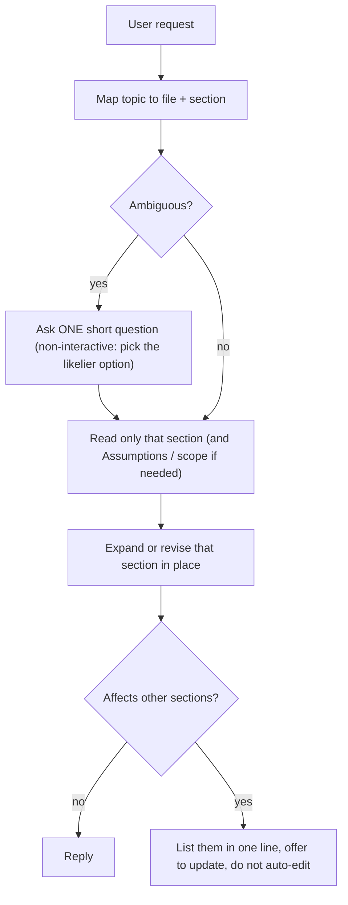

# Refinement Rules

Step 5, after the output files exist. The user can go deeper on, revisit, or change a constraint behind one topic without regenerating everything.

## Principle

**Expand only what was asked.** Never regenerate all files. Touch the smallest section that answers the request. Refinements edit files in place and never archive (archiving is for full re-runs, `references/archive-and-diff.md`).

## Trigger Phrases

| User says | Action |
|---|---|
| "Go deeper on X" / "more detail on X" | Expand the section covering X |
| "Revisit X" / "reconsider X" | Re-evaluate the decision on X and update it |
| "Why did you choose X?" | Answer in chat; edit files only if the user then asks for a change |
| "Change constraint Y" (scale, stack, team, budget) | Update Assumptions & Constraints (or the `> Context:` line), then re-check only sections that depend on Y |
| "Generate the tech stack comparison" | Create `04-tech-stack-comparison.md` from `templates/optional/` |
| "Write an ADR for X" (Mode 2 / Quick) | Write one ADR per `references/adr-guide.md` |
| "full" / "detailed" after a Quick run | Not a refinement: run the full workflow (it archives the quick file first) |
| "Re-run the audit" / "audit again" | Not a refinement: full re-run with archive and diff |

## Topic-to-Section Map

### Mode 1

| Topic | File | Section |
|---|---|---|
| Users, external systems, C4 Context | `01-system-design.md` | System Context |
| Components, C4 Container | `01-system-design.md` | Core Components |
| Main request flow | `01-system-design.md` | Data Flow |
| QPS, storage, bandwidth, cache size | `01-system-design.md` | Capacity Estimates |
| Architectural choices | `01-system-design.md` | Key Architectural Decisions (+ matching ADR) |
| Monolith vs microservices | `02-architecture-decisions.md` | Pattern Choice |
| Scaling, caching layers, load balancing | `02-architecture-decisions.md` | Scaling Strategy |
| Database choice | `02-architecture-decisions.md` | Data Storage |
| Entities, indexes, ER diagram | `02-architecture-decisions.md` | Data Model |
| Failures, resilience | `02-architecture-decisions.md` | Failure Modes |
| Threats, auth hardening | `02-architecture-decisions.md` | Security |
| Logs, metrics, traces, alerts | `02-architecture-decisions.md` | Observability |
| Hosting, monthly cost | `02-architecture-decisions.md` | Deployment & Cost |
| REST/GraphQL/gRPC | `03-api-design-and-optimization.md` | API Style |
| Versioning, naming, errors | `03-api-design-and-optimization.md` | Endpoint Conventions |
| Endpoint list, OpenAPI | `03-api-design-and-optimization.md` | Endpoints |
| Auth, rate limits | `03-api-design-and-optimization.md` | Auth & Rate Limiting |
| API caching | `03-api-design-and-optimization.md` | Caching Strategy |
| Pagination, N+1, batching | `03-api-design-and-optimization.md` | Performance Notes |

### Mode 2

| Topic | File | Section |
|---|---|---|
| Progress since the last audit | `01-architecture-issues.md` | Change Since Last Audit |
| Score, sub-scores, band | `01-architecture-issues.md` | Architecture Health Score |
| A specific issue (`SYS-`, `SCL-`, `REL-`, `SEC-`, `OBS-`, `MNT-`) | `01-architecture-issues.md` | Row with that ID in its severity table |
| A specific API issue (`API-`) | `02-api-optimization.md` | Row with that ID in Issues Found |
| Endpoint groups | `02-api-optimization.md` | API Health Snapshot |
| Routes found | `02-api-optimization.md` | Endpoint Inventory |
| Caching wins | `02-api-optimization.md` | Caching Opportunities |
| Cheap vs expensive fixes | `02-api-optimization.md` | Quick Wins vs Structural Fixes |
| Order of work, timeline | `03-improvement-roadmap.md` | `Action (IDs)` row with that ID / Suggested Sequence |

### Quick

| Topic | File | Section |
|---|---|---|
| Any design topic | `quick-design.md` | Matching section (Architecture, Key Decisions, API Sketch, Risks) |
| A specific issue | `quick-audit.md` | Row with that ID in Top Issues |

## Procedure



Non-interactive: wherever this file says to ask (ambiguous topic, out-of-scope request), pick the likelier option and state it in the reply instead of waiting.

## Rules

1. **Edit in place.** Modify the target section inside the existing file; do not create a new file (except `04-*` or an ADR when asked).
2. **Keep the format.** Same headers, tables and fixed vocabulary as `references/formatting-rules.md`; one-line "Why" on every recommendation.
3. **Go deeper means more specific, not longer prose.** Add concrete numbers, configs, examples and trade-offs in tables or bullets. Stay within about half a page per section; split into sub-tables if needed.
4. **New context wins.** If the user gives new facts (traffic doubled, team shrank), update Assumptions & Constraints first, then revise the affected sections (Capacity Estimates first in Mode 1).
5. **IDs are stable.** Never renumber issues. A new issue gets the next unused number for its prefix; a removed issue's ID is never reused.
6. **Mode 2 consistency.** If a refinement changes an issue's severity or adds/removes an issue, update the sub-score and headline from the rubric lookup table, keep the ID in exactly one roadmap `Action (IDs)` row, and tell the user in one line.
7. **Mode 1 decisions.** If a revisited decision changes, update the Key Architectural Decisions row and write a superseding ADR (`references/adr-guide.md`), unless the user opted out of ADRs.
8. **Report briefly.** Reply with file, section changed, one-line summary and impacted sections. Do not repeat unchanged content.

## Reply Format

```
Updated: 02-architecture-decisions.md > Data Storage
Change: added read-replica plan and failover threshold
Impacted (not changed): 02 > Failure Modes, 03 > Caching Strategy
```

## Limits

- Never regenerate all files unless the user explicitly asks to redo everything (that is a re-run: archive first).
- Never create `04-tech-stack-comparison.md` unless explicitly requested.
- If a request is outside the original scope (new service, new module), say so in one line and ask whether to extend the scope before editing (non-interactive: pick the likelier option and state it in the reply).
