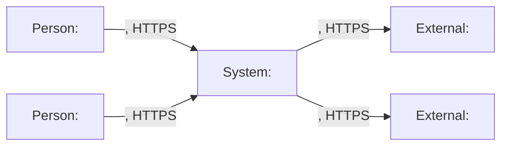
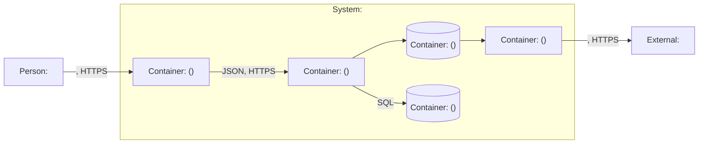
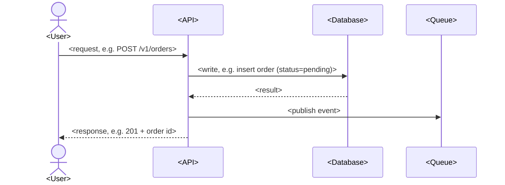

# System Design

> Scope: <project name>
> Context: <scale> users, team of <size>, <key constraint>

## Overview

<2–3 lines: what the system does, who it is for, the one constraint that shapes it most>

## System Context

## Core Components

| Component | Responsibility | Why it exists |
|---|---|---|
| <name> | <what it does> | <reason it is a separate component> |
| <name> | <what it does> | <reason it is a separate component> |

## Data Flow

Main request: <name of the request, e.g. "place order">

- <step that needs a note: validation, idempotency key, transaction boundary>
- <async side effect and what happens if it fails>

## Capacity Estimates

Formulas in `references/capacity-estimation.md`.

| Metric | Formula | Value |
|---|---|---|
| Daily requests | <DAU> × <requests per user per day> | <value> |
| Average QPS | <daily requests> / 86,400 | <value> |
| Peak QPS | 3× average | <value> |
| Read / write split | <read %> / <write %> of peak QPS | <value> / <value> |
| Storage per year | <writes/day> × <record size> × 365 × <replication> | <value> |
| Bandwidth (peak) | <peak QPS> × <avg response size> | <value> |
| Cache size (hot set) | 20% × <daily reads> × <object size> | <value> |

<one line: what these numbers mean for the design>

## Key Architectural Decisions

| Decision | Chosen | Alternative considered | Why |
|---|---|---|---|
| <decision area> | <chosen option> | <alternative> | <reason> |
| <decision area> | <chosen option> | <alternative> | <reason> |

ADRs: one per row (max 5) in `docs/adr/`, unless the user opted out.

## Assumptions & Constraints

- <assumption or constraint from context collection>
- <default assumed where the user said "you decide", or `Assumed (non-interactive)`>
