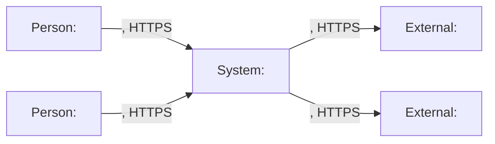
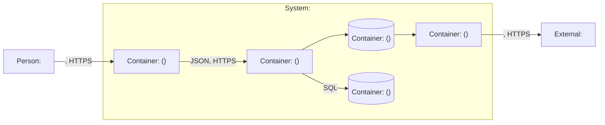
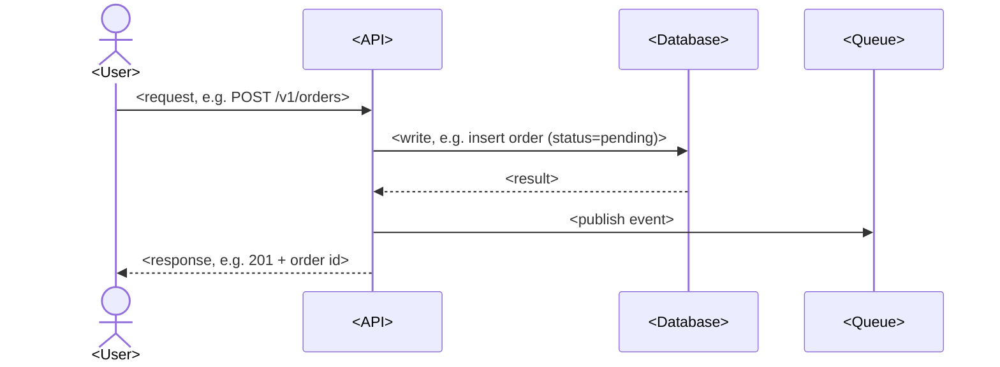

# System Design

> Scope: <project name>
> Context: <scale> users, team of <size>, <key constraint>
> Format: 1.0.2
> Audit: plugin 1.1.0 · scanner not run · rev <sha|unknown> · <timestamp>

## Overview

<2–3 lines: what the system does, who it is for, the one constraint that shapes it most>

### Requirements

| Requirement | Value | Source | Effect on design |
|---|---|---|---|
| Goal | <what the system must achieve, for whom> | <user / assumption> | <what this changes in the design> |
| Functional | <the key capabilities> | <user / assumption> | <modules or components it needs> |
| Non-functional | <latency, throughput, consistency targets, e.g. p95 < 300 ms> | <user / assumption> | <caching, async work, store choice> |
| Roles | <user roles and what each may do> | <user / assumption> | <auth model, separate clients> |
| Traffic and data estimate | <users, peak req/s, data volume now and in 12 months> | <user / assumption> | <Capacity Estimates inputs; sharding or not> |
| Availability and recovery target | <uptime %, RPO, RTO> | <user / assumption> | <replicas, backups, failover> |
| Compliance | <GDPR, PCI DSS, HIPAA, or none> | <user / assumption> | <data placement, threat model depth> |
| Budget | <monthly infra budget, or cost-sensitive> | <user / assumption> | <managed vs self-run, Deployment & Cost> |
| Deployment constraint | <cloud or on-prem, regions, managed services allowed> | <user / assumption> | <hosting shape> |
| Team capacity | <size, seniority, who is on call> | <user / assumption> | <how much operational complexity is allowed> |

Source is `user` (stated) or `assumption` (`assumption (non-interactive)` when no questions could be asked); every assumption is also listed under Assumptions & Constraints. One row per item, all ten rows.

## System Context

## Core Components

`worker` and `queue` are optional examples, not defaults (proportionality rule in `references/formatting-rules.md`).

| Component | Responsibility | Required now / Later | Why it exists |
|---|---|---|---|
| <name> | <what it does> | Required now | <reason it is a separate component> |
| <name> | <what it does> | <Later: when <trigger, e.g. peak QPS > 200>> | <reason it is a separate component> |

`Later` components stay out of the diagram until their trigger is met (proportionality rule in `references/formatting-rules.md`).

## Data Flow

Main request: <name of the request, e.g. "place order">

- <step that needs a note: validation, idempotency key, transaction boundary>
- <async side effect and what happens if it fails>

## Capacity Estimates

Formulas in `references/capacity-estimation.md`.

| Metric | Formula | Value |
|---|---|---|
| Daily requests | <DAU> × <requests per user per day> | <value> |
| Average QPS | <daily requests> / 86,400 | <value> |
| Peak QPS | 3× average | <value> |
| Read / write split | <read %> / <write %> of peak QPS | <value> / <value> |
| Storage per year | <writes/day> × <record size> × 365 × <replication> | <value> |
| Bandwidth (peak) | <peak QPS> × <avg response size> | <value> |
| Cache size (hot set) | 20% × <daily reads> × <object size> | <value> |

<one line: what these numbers mean for the design>

## Key Architectural Decisions

| Decision | Chosen | Alternative considered | Why |
|---|---|---|---|
| <decision area> | <chosen option> | <alternative> | <reason> |
| <decision area> | <chosen option> | <alternative> | <reason> |

One trade-off table per decision row, 2–3 options each; rate each column Low / Medium / High with the reason that matters here.

### Trade-offs: <decision area>

| Option | Complexity | Scalability | Reliability | Security | Operations | Cost | Familiarity | Lock-in | Migration path |
|---|---|---|---|---|---|---|---|---|---|
| <option A> (chosen) | <Low: one deployable> | <Medium: scales as one unit> | <rating: reason> | <rating: reason> | <rating: reason> | <rating> | <rating: team knows it?> | <rating: provider-specific parts> | <how to move off it later> |
| <option B> | <rating: reason> | <rating: reason> | <rating: reason> | <rating: reason> | <rating: reason> | <rating> | <rating> | <rating> | <how to move off it later> |

ADRs: one per row (max 5) in `docs/adr/`, unless the user opted out.

## Requirements → Decisions

| Requirement | Decision(s) | How it is met |
|---|---|---|
| <e.g. p95 < 300 ms> | <e.g. Pattern, Caching> | <e.g. single-hop reads served from Redis> |
| <e.g. team of 3> | <e.g. Pattern> | <e.g. one deployable, no service mesh> |

Every captured requirement has a row; a requirement no decision covers is a gap to fix or to state under Assumptions & Constraints.

## Assumptions & Constraints

- <assumption or constraint from context collection>
- <default assumed where the user said "you decide", or `Assumed (non-interactive)`>
