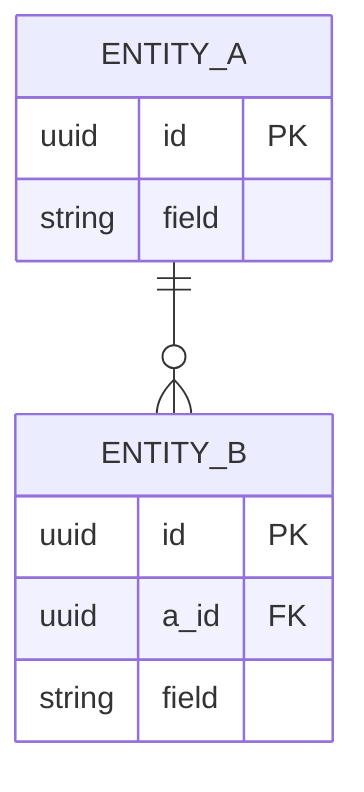

# Architecture Decisions

> Scope: <project name>
> Context: <scale> users, team of <size>, <key constraint>
> Format: 1.0.2
> Audit: plugin 1.1.0 · scanner not run · rev <sha|unknown> · <timestamp>

## Pattern Choice

**Chosen: <Monolith / Modular Monolith / Microservices>**

<2–3 lines justifying the pick against the Requirements table; the options are compared in the pattern trade-off table in `01-system-design.md` (Key Architectural Decisions)>

## Scaling Strategy

| Layer | Approach | Why |
|---|---|---|
| Compute | <horizontal / vertical> | <reason> |
| Caching | <what is cached, where> | <reason> |
| Load balancing | <approach> | <reason> |
| Async work | <queue / none> | <reason> |

## Data Storage

| Store | Choice | Why |
|---|---|---|
| Primary DB | <e.g. PostgreSQL> | <reason> |
| <Cache / object store / search, only if needed> | <choice> | <reason> |
| <Replication or sharding, only if relevant> | <approach> | <reason> |

## Data Model

| Entity | Key fields | Relationships | Key indexes (why) |
|---|---|---|---|
| <Entity A> | <id, field, field> | <has many Entity B> | <(field, created_at): list by owner> |
| <Entity B> | <id, a_id, field> | <belongs to Entity A> | <(a_id): join to A> |

## Failure Modes

| Scenario | Consequence | Mitigation | Why |
|---|---|---|---|
| <e.g. DB primary goes down> | <consequence> | <mitigation> | <reason> |
| <e.g. downstream provider timeout> | <consequence> | <mitigation> | <reason> |

## Security & Threat Model

Trust boundaries: <e.g. internet → API (TLS, auth), API → database (private network), API → payment provider (outbound HTTPS, signed webhooks back)>

| Threat (STRIDE) | Boundary | Asset | Mitigation | Why |
|---|---|---|---|---|
| <Spoofing: stolen session token> | <internet → API> | <user accounts> | <short-lived JWT + refresh rotation> | <reason> |
| <Tampering: SQL injection> | <API → database> | <primary DB> | <parameterized queries only> | <reason> |
| <Repudiation: disputed order> | <internet → API> | <orders> | <append-only audit log with user ID> | <reason> |
| <Information disclosure: secrets in repo> | <CI → runtime> | <provider keys> | <secret manager, env injection> | <reason> |
| <Denial of service: request flood> | <internet → API> | <API capacity> | <rate limit per user and IP> | <reason> |
| <Elevation of privilege: admin route reachable by users> | <API> | <admin actions> | <role check in middleware, deny by default> | <reason> |

Keep only the threats that apply; data sensitivity from Assumptions & Constraints decides how deep this goes.

## Observability

| Signal | What | Alert threshold | Why |
|---|---|---|---|
| Logs | <structured JSON, request ID, user ID> | — | <reason> |
| Metrics (RED) | <rate, errors, duration per endpoint> | <e.g. 5xx > 1% for 5 min; p95 > 300 ms> | <reason> |
| Metrics (USE) | <CPU, memory, DB connections, queue depth> | <e.g. DB connections > 80%> | <reason> |
| Traces | <OpenTelemetry across API → DB → provider> | — | <reason> |

## Deployment & Cost

| Component | Runs on | Size / count | Monthly cost (USD) |
|---|---|---|---|
| <API> | <e.g. managed containers> | <e.g. 2 × 1 vCPU> | <range> |
| <Database> | <e.g. managed PostgreSQL> | <e.g. 2 vCPU, 8 GB + replica> | <range> |
| <Cache / queue> | <service> | <size> | <range> |

Total: about <low>–<high> USD/month. Assumptions: <region, traffic from Capacity Estimates, pricing tier>.

## Trade-offs Accepted

- <what is sacrificed> for <what gain> (the weaker columns of the chosen options in the `01` trade-off tables)
- <what is sacrificed> for <what gain>
