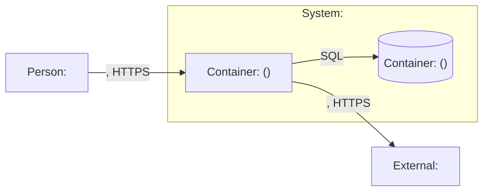

# Quick Design

> Scope: <component, feature or small system>
> Context: <scale>, team of <size>, <key constraint>

## Overview

<2–3 lines: what is being built, for whom, the constraint that shapes it most>

## Architecture

- <component>: <responsibility>. Why: <reason it exists>

## Key Decisions

| Decision | Chosen | Alternative considered | Why |
|---|---|---|---|
| <decision area> | <chosen option> | <alternative> | <reason> |

## API Sketch

| Method | Path | Purpose | Request → Response |
|---|---|---|---|
| <POST> | </v1/resources> | <purpose> | <fields → 201 resource> |

## Risks

| Risk | Severity | Mitigation | Why |
|---|---|---|---|
| <risk> | <Critical/High/Medium/Low> | <mitigation> | <reason> |

## Assumptions & Constraints

- <assumption or constraint; defaults marked `Assumed (non-interactive)` when no questions could be asked>
